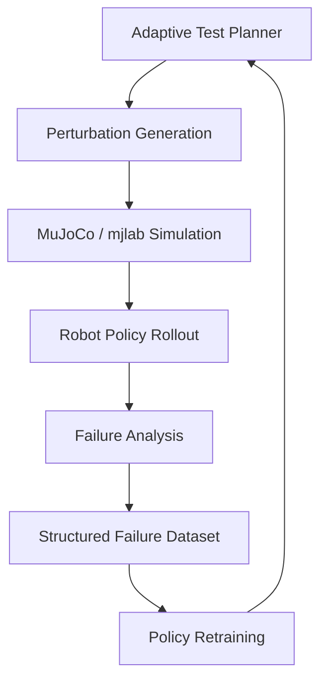

# 🐜 Ants
### Adversarial Neural Testing Swarm for Physical AI

**Finding the failure modes of robotic policies before deployment.**

## Abstract

Robotic policies trained through reinforcement learning can perform well under nominal conditions while failing under distribution shifts, including changes in terrain, actuator dynamics, lighting, sensor noise, and external disturbances.

Ants is a research project exploring adversarial testing for physical AI. It aims to systematically discover these failures by generating controlled environmental perturbations, evaluating robot policies in simulation, and converting observed failures into structured data for analysis and retraining.

The initial implementation targets a Microduck-based robotics workflow using MuJoCo/mjlab and the BallKick task.

The central idea is simple: **actively search for the conditions under which a robot policy fails, then use those failures to improve its robustness.**

## Research Problem

Most policy evaluation pipelines rely on nominal benchmarks, random environment variations, or manually designed test scenarios. These approaches may overlook important failure modes and provide limited guidance for improving the policy.

Ants investigates three questions:

- Can adaptive perturbation generation discover failures more efficiently than random testing?
- Can multimodal analysis help characterize the conditions that cause a policy to fail?
- Can retraining on discovered failure cases improve performance under previously unseen conditions?

## Methodology

Ants treats policy evaluation as an iterative adversarial search process.

1. **Generate:** Create controlled perturbations to the environment, robot dynamics, or observations.
2. **Evaluate:** Execute a trained policy under each perturbed condition.
3. **Measure:** Record task outcomes, video, and robot telemetry.
4. **Analyze:** Identify and categorize failure modes.
5. **Improve:** Use selected failure cases for retraining and regression testing.
6. **Repeat:** Test the updated policy against known and unseen conditions.

## Architecture

The proposed architecture combines agent-driven experiment generation with simulation-based evaluation and structured failure analysis.

### Components

| Component | Role |
|---|---|
| Test planner | Selects perturbation families based on previous results |
| Perturbation generator | Creates validated environment and observation variations |
| MuJoCo / mjlab | Executes controlled simulation experiments |
| Robot policy | Performs the task under perturbed conditions |
| Failure analysis | Combines task metrics, video, and telemetry |
| Failure dataset | Stores reproducible failure cases and metadata |
| Retraining loop | Uses selected failures to evaluate potential robustness improvements |

Agentic models can assist with experiment planning, configuration generation, and failure interpretation. Deterministic evaluation code remains responsible for validating configurations and measuring objective task outcomes.

## Perturbation Space

Initial experiments focus on five categories:

- **Terrain:** Surface friction, geometry, and uneven ground.
- **Actuation:** Motor strength, latency, backlash, and control noise.
- **Proprioception:** Sensor noise, bias, and observation delays.
- **Vision:** Lighting, textures, occlusion, and visual distractors.
- **Disturbances:** External forces and unexpected object interactions.

Perturbations are applied within predefined bounds. Individual factors and their combinations can be evaluated separately to identify which conditions contribute to performance degradation.

## Experimental Evaluation

Ants will be evaluated against fixed testing baselines under comparable rollout budgets.

| Baseline | Purpose |
|---|---|
| Nominal evaluation | Establish reference policy performance |
| Random testing | Measure failures discovered through random perturbations |
| Fixed test suite | Evaluate manually specified scenarios |
| Adaptive testing | Measure the value of feedback-driven perturbation selection |

Key metrics include:

- Task success rate under nominal and perturbed conditions.
- Number of unique, reproducible failures discovered.
- Failure discovery rate per simulation rollout.
- Coverage of the defined perturbation space.
- Agreement between automated failure labels and human review.
- Robustness improvement on held-out scenarios after retraining.

A central evaluation is the number of unique failure modes discovered as a function of simulation budget. This provides a direct measure of whether adaptive testing offers an advantage over conventional approaches.

## Initial Demonstration

The first experimental setting is a Microduck-based BallKick task in MuJoCo/mjlab.

The intended demonstration follows a single policy through the complete testing cycle:

1. Evaluate a trained policy under nominal conditions.
2. Introduce controlled visual or physical perturbations.
3. Identify and reproduce a policy failure.
4. Generate a structured record containing the perturbation, outcome, and relevant telemetry.
5. Retrain the policy using selected failure cases.
6. Compare the updated policy against known failures and held-out perturbations.

The objective is to connect failure discovery to measurable policy improvement, rather than producing isolated failure demonstrations.

## Research Scope

Ants focuses on simulation-based robustness testing and failure-driven policy improvement. It does not assume that simulation results automatically transfer to physical hardware.

Important limitations include incomplete simulator fidelity, restricted perturbation coverage, uncertainty in automated failure classification, and the risk of overfitting to known failure cases.

Future evaluation should include hardware validation, additional robotic tasks, and tests of generalization across unseen perturbations.

## Status

The project is under development. The architecture and evaluation protocol describe the intended research direction; implementation completeness and experimental claims will be updated as reproducible results become available.

## References and Tools

- [MuJoCo](https://mujoco.org/) — Physics simulation for robotics.
- [mjlab](https://github.com/mujocolab/mjlab) — Reinforcement learning workflows for MuJoCo.
- [Gymnasium](https://gymnasium.farama.org/) — Standardized reinforcement learning environments.
- [Proximal Policy Optimization (PPO)](https://arxiv
